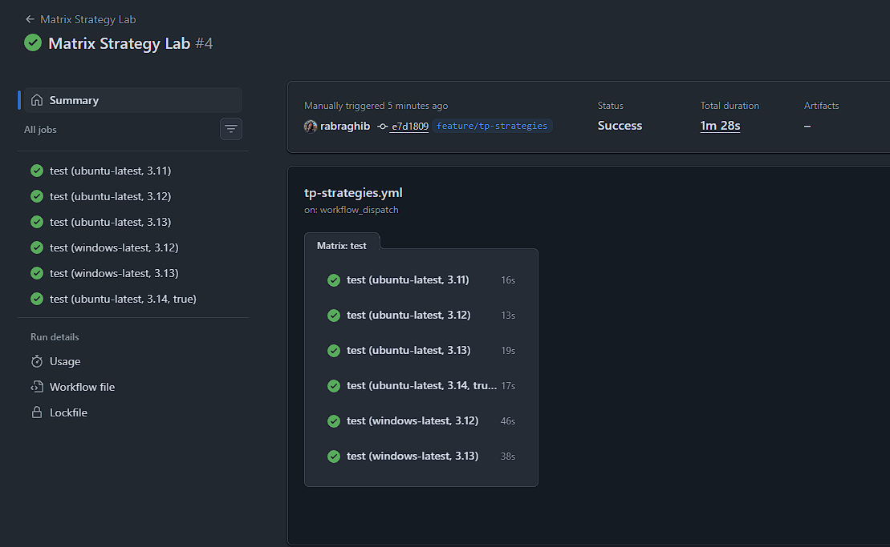

# TP 8 – Stratégies GitHub Actions

## Partie 1 – La matrice de base

**Q1. Combien de jobs sont générés ? Donnez la liste des combinaisons.**

La matrice génère **6 jobs**, tous réussis. [Exécution du commit `1bc01d4`](https://github.com/rabraghib/S9-DevOps-TPs/actions/runs/45867930441)

| Runner           | Versions de Python |
| ---------------- | ------------------ |
| `ubuntu-latest`  | 3.11, 3.12, 3.13   |
| `windows-latest` | 3.11, 3.12, 3.13   |

## Partie 2 – `exclude` et `include`

**Q2. Combien de jobs au total ?**

Il reste **6 jobs**. `exclude` retire Windows 3.11, puis `include` ajoute Ubuntu 3.14 avec `experimental: true`. `continue-on-error` autorise l'échec de ce job expérimental.

**Q3. Que se passerait-il si vous tentiez d'exclure la combinaison 3.14 ? Pourquoi ?**

Le job Ubuntu 3.14 resterait présent. Lors du passage de `exclude`, la matrice de base contient Python 3.11 à 3.13. `include` ajoute 3.14 ensuite. Pour retirer ce job, il faut retirer son entrée de `include`.

## Partie 3 – `fail-fast`

**Q4. Quelle est la différence observée ? Dans quel cas choisiriez-vous `true` ? `false` ?**

| Stratégie et commit                                                                        | Réussis                       | Échoués            | Annulés      |
| ------------------------------------------------------------------------------------------ | ----------------------------- | ------------------ | ------------ |
| [`true` · `7861546`](https://github.com/rabraghib/S9-DevOps-TPs/actions/runs/45868745667)  | Ubuntu 3.11, 3.12, 3.13, 3.14 | Windows 3.12       | Windows 3.13 |
| [`false` · `e75b7aa`](https://github.com/rabraghib/S9-DevOps-TPs/actions/runs/45869278836) | Ubuntu 3.11, 3.12, 3.13, 3.14 | Windows 3.12, 3.13 | Aucun        |

`tests/test_break.py` échoue sur Windows parce que `sys.platform` vaut `win32`. Le fichier temporaire a ensuite été supprimé.

`true` annule les jobs en attente ou en cours après un échec bloquant. Ce réglage convient pour obtenir un signal rapide et économiser du temps runner. `false` laisse tous les jobs aller au bout pour comparer les résultats sur chaque système et chaque version.

## Partie 4 – `max-parallel`

Au démarrage du run, Ubuntu 3.11 et 3.12 étaient en cours et les quatre autres jobs attendaient. Les jobs suivants ont démarré au fur et à mesure que des places se libéraient. Les six jobs ont réussi en 1 min 28 s. [Exécution du commit `e7d1809`](https://github.com/rabraghib/S9-DevOps-TPs/actions/runs/45869848463)

**Q5. Donnez deux raisons d'utiliser `max-parallel` en entreprise.**

- Respecter la capacité d'un parc de runners partagé et laisser des créneaux aux autres pipelines.
- Éviter de saturer une ressource de test partagée, par exemple une API soumise à des quotas.

**Matrice finale**

